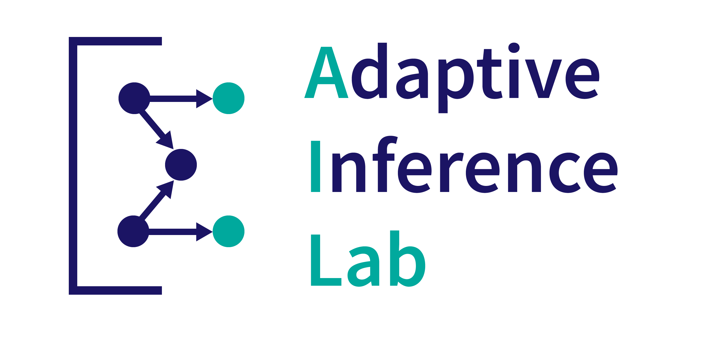

Welcome to the <strong>A</strong>daptive <strong>I</strong>nference <strong>Lab</strong> at the <a href="//wisc.edu">University of Wisconsin-Madison</a>.
We build statistical AI systems for context-aware healthcare.

Quick links:

- [Our People](/people)
- [Our Publications](/publications)
- [Our Current Projects](/projects)
- <a href="/resources/advice/joining" class="important-link">Apply to join us</a> (current UW-Madison students, postdocs, and collaborators)
- [Prospective PhD students](/resources/advice/prospective_students): please apply through the department rather than emailing me

<form
  action="https://buttondown.com/api/emails/embed-subscribe/lengerichlab"
  method="post"
  target="popupwindow"
  onsubmit="window.open('https://buttondown.com/lengerichlab', 'popupwindow')"
  class="embeddable-buttondown-form"
>
  <label for="bd-email">Subscribe to email updates (semesterly):</label>
  <input type="email" name="email" id="bd-email" />

  <input type="submit" value="Subscribe" />
</form>

